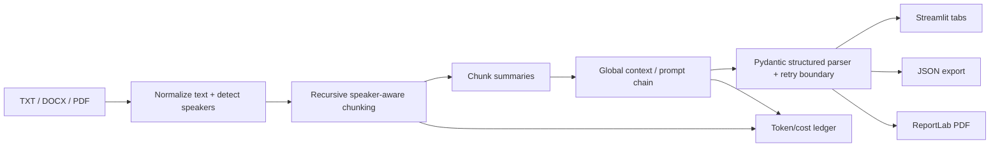

# Architecture and data flow

The default provider is deterministic mock mode so the demo works without a paid key. When `LLM_PROVIDER=openai` and `OPENAI_API_KEY` are set, the provider boundary uses LangChain structured output support. Parse/provider failures fall back to the local extraction path rather than crashing the UI.
